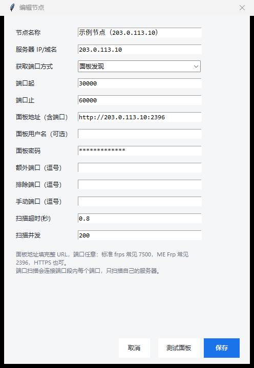

# 节点填写示例

上图是示例填法（IP 使用文档保留地址，密码已打码）。

## 示例值

| 字段 | 值 |
|---|---|
| 节点名称 | 示例节点（203.0.113.10） |
| 服务器 IP/域名 | `203.0.113.10` |
| 获取端口方式 | 面板发现 |
| 端口起 / 止 | `30000` / `60000` |
| 面板地址（含端口） | `http://203.0.113.10:2396` |
| 面板用户名（可选） | 留空 |
| 面板密码 | 面板的访问密钥（ME Frp 就这一项） |
| 额外/排除/手动端口 | 留空 |
| 扫描超时 / 并发 | `0.8` / `200` |

## 别人拿到后只改这几项

1. **节点名称**：随便写，例如“我的节点”。
2. **服务器 IP/域名**：换成他自己的机器。
3. **获取端口方式**：
   - `面板发现`：有 frps / ME Frp 面板，自动读隧道
   - `端口扫描`：没有面板，或只想知道哪些端口开着（只扫自己的服务器）
   - `手动列表`：隧道不多，直接在“手动端口”里写 `80,443,8080`
4. **面板地址（含端口）**：填完整 URL，端口按实际：
   - ME Frp：一般是 `http://IP:2396`
   - 标准 frps：一般是 `http://IP:7500`
   - 套了域名/HTTPS 也可以：`https://frp.example.com`
5. **面板用户名**：
   - ME Frp **没有用户名**，留空
   - 标准 frps 一般留空（程序按 `admin` 处理），改过 `webServer.User` 才需要填
6. **面板密码**：
   - ME Frp 填“访问密钥”
   - 标准 frps 填 `webServer.Password`
7. **端口起 / 止**：面板里有隧道就填实际范围；扫描模式就填想扫的区间。
8. 点 **测试面板**：提示“发现 N 条 TCP 隧道”就说明填对了；再点 **保存**。

## 三种填法对照

| 场景 | 获取端口方式 | 需要填 |
|---|---|---|
| 自己的 ME Frp 节点 | 面板发现 | IP、面板地址、面板密码 |
| 自己的标准 frps | 面板发现 | IP、面板地址、面板密码（用户名可留空） |
| 普通服务器，没有面板 | 端口扫描 | IP、端口起止（可调超时/并发） |
| 只盯几个站 | 手动列表 | IP、手动端口 |

## 注意

- “测试面板”会真的登录一次；连续输错太多次可能被面板临时锁 IP。
- 面板密码存在 `profiles/<节点id>.json` 里，发源码/整个目录给别人前先删掉 `profiles/`。
- 端口扫描只对自己的服务器用，不要扫别人。
